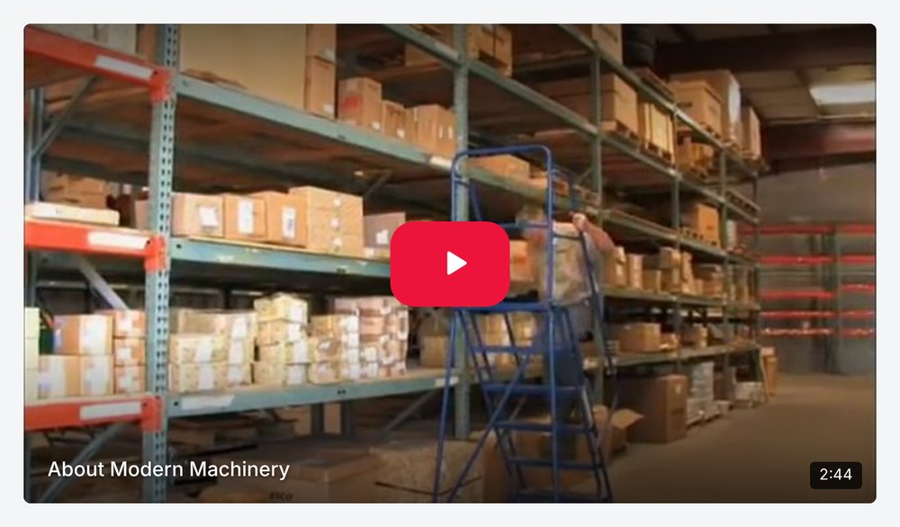
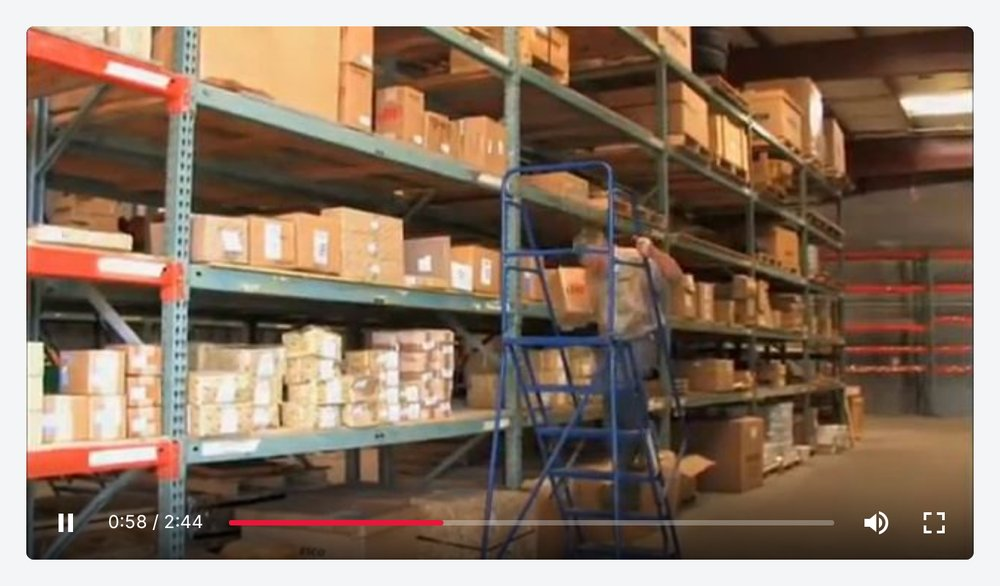
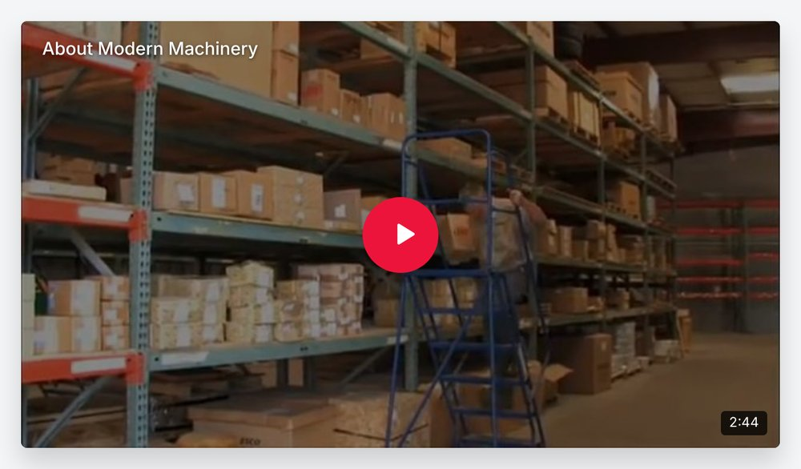
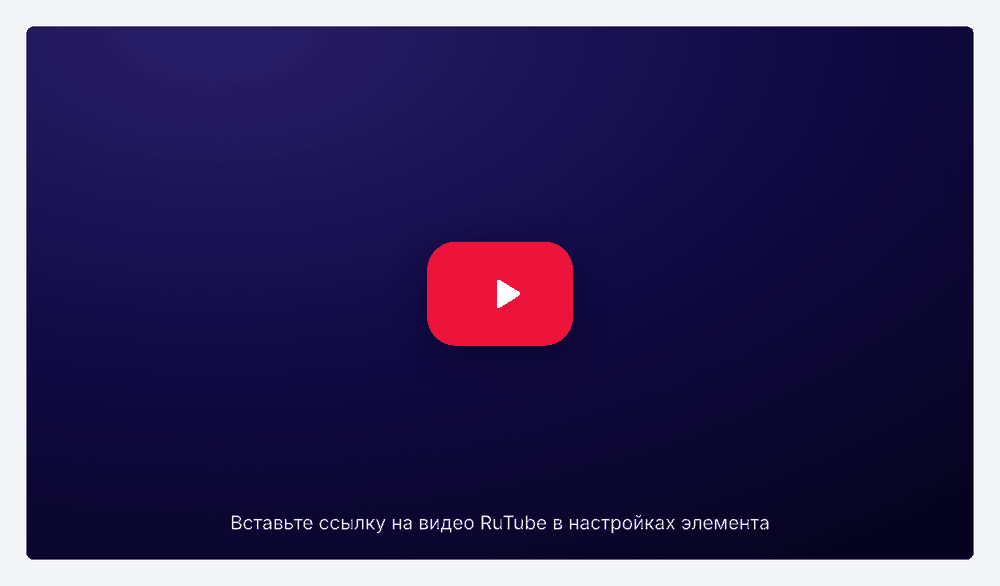

# YT RuTube

**Lazy RuTube video for YOOtheme Pro on Joomla** — a builder element that shows a light poster with a play button and loads the RuTube player only when it is needed. The same idea as Lazy Video for YouTube and Vimeo, made for RuTube.

[Русская версия](README.ru.md)


A regular RuTube embed loads the whole player, its scripts, ads and counters with the page. YT RuTube renders only an image and a button; the iframe appears after a click. Pages load faster and no third-party cookies are set before the visitor decides to watch.

| Poster | Own player controls |
|---|---|
|  |  |

| Circle play button, title on top | Builder placeholder until a link is set |
|---|---|
|  |  |

*Video in the screenshots: [About Modern Machinery](https://rutube.ru/video/5c3731210a7b462285456a4fb90e9009/) on RuTube.*

## Features

**RuTube element** (group *Multimedia* in the YOOtheme Pro element library)

- **RuTube and VK Video.** Paste a VK Video link (`vkvideo.ru/video-220018529_456249432`, `vk.com/video-…`, clips, `video_ext.php` embed links or iframe code) and the element shows it the same way: poster, title and duration from VK, lazy loading and own controls through the [VK player JS API](https://dev.vk.com/ru/widgets/video).
- Accepts any RuTube link: `rutube.ru/video/…`, `/shorts/…`, private videos `/video/private/…?p=…`, `/play/embed/…`, a full `<iframe>` embed code or just the video ID. `?t=90` in the link sets the start time.
- Title, poster and duration are fetched from the RuTube API on the server and cached. Your own poster and title can be set instead. All content fields support dynamic content.
- Loading modes: **on click in place**, **on click in a lightbox** (UIkit) and **when scrolled into view**.
- Aspect ratio: 16:9, 4:3, 21:9, 1:1, 4:5, 9:16 (Shorts) or custom.
- Play button: RuTube style, circle, outline, icon only or none; three sizes, custom colors.
- Poster overlay (light, dark, gradient), zoom on hover, title (top or bottom), duration badge, border radius, box shadow.
- **Player controls:** the standard RuTube player (default) or **own controls**. With own controls the RuTube player is covered, so viewers can't open RuTube, share, use its settings menu or recommendations — the video plays only in its window and in fullscreen. Until the video starts (and while ads play) clicks go to the RuTube player, because browsers may require a click inside it to start playback. Every control can be turned off: play/pause, progress bar, seeking, time, sound, fullscreen, pause on click, auto-hide.
- With own controls, after the video ends the poster is shown again instead of the RuTube end screen with recommendations.
- Until a video link is set, the builder shows a placeholder with a play button; the site shows nothing.
- Player options: start time, start muted, player color, pause other RuTube videos on the page. They are applied through the official [RuTube player postMessage API](https://github.com/rutube/RutubePlayerJSAPI).
- SEO: `VideoObject` structured data (JSON-LD) with title, description, poster, duration and publication date.
- Accessible: the poster is a `<button>` with an `aria-label`, keyboard focus, `<noscript>` fallback.
- Standard YOOtheme *General* and *Advanced* settings: margins, max width, alignment, animation, visibility, custom CSS.
- English and Russian translations for the builder and the site.

## Requirements

- Joomla 5.0 or later
- YOOtheme Pro 5
- PHP 8.1 or later
- Outgoing HTTPS from the server to `rutube.ru` and `vk.com` for titles, posters and durations (RuTube posters work without it)

## Installation

1. Download `plg_system_ytrutube_<version>.zip` from [Releases](../../releases).
2. In Joomla go to *System → Install → Extensions* and upload the file. The plugin is enabled automatically.
3. Open *YOOtheme → Builder*, click **+** and add the **RuTube** element. Paste a video link, for example `https://rutube.ru/video/5c3731210a7b462285456a4fb90e9009/`.

To update, install the new version over the old one or use *System → Update → Extensions*.

## Plugin settings

| Setting | Default | Description |
|---|---|---|
| Video data cache | 720 min | How long title, poster and duration from the RuTube API are cached. Failed requests are retried after an hour. |

To refresh the data right away, clear the `plg_system_ytrutube` group in *System → Clear Cache*.

## Troubleshooting

- **Video does not start or pause with an ad blocker.** This concerns own controls; with the standard RuTube player (default) the player handles it itself. Ad blockers break the RuTube player's ad module (the console shows `ERR_BLOCKED_BY_CLIENT` and `Ya is not defined` from RuTube). YT RuTube works around it: own controls are replaced by the RuTube controls, which keep working (the top bar of the player with the title and links stays covered). If the video still misbehaves, check the page with the blocker turned off.
- **Diagnostics.** Open the page with `?ytrutube_debug=1`, e.g. `https://example.com/page?ytrutube_debug=1`: player events and commands are logged to the browser console (F12 → Console), lines start with `[YT RuTube]`.

## Development

```
src/
  plg_system_ytrutube/   system plugin
    modules/element/     RuTube builder element (element.json, templates)
    modules/src/         RutubeHelper (links, API, cache), builder translations
    modules/assets/      front-end CSS and JS
tests/                   PHP tests (link, time and ratio parsing)
updates/                 Joomla update server XML
build.sh                 lint, test and build dist/plg_system_ytrutube_<version>.zip
```

```sh
./build.sh          # PHP lint, JSON and JS checks, tests, build
./build.sh --fast   # build only
```

Releases are published by GitHub Actions. To release a new version, update the version in `ytrutube.xml`, `RutubeHelper::VERSION`, `updates/plg_system_ytrutube.xml` and `CHANGELOG.md`, then push to `main`: when the version has no release yet, the workflow creates the tag `vX.Y.Z` and a release with the installable plugin.

## License

GNU General Public License version 2 or later. See [LICENSE](LICENSE).

YOOtheme Pro, RuTube and Joomla are trademarks of their respective owners. This project is not affiliated with YOOtheme GmbH, RuTube or Open Source Matters.
