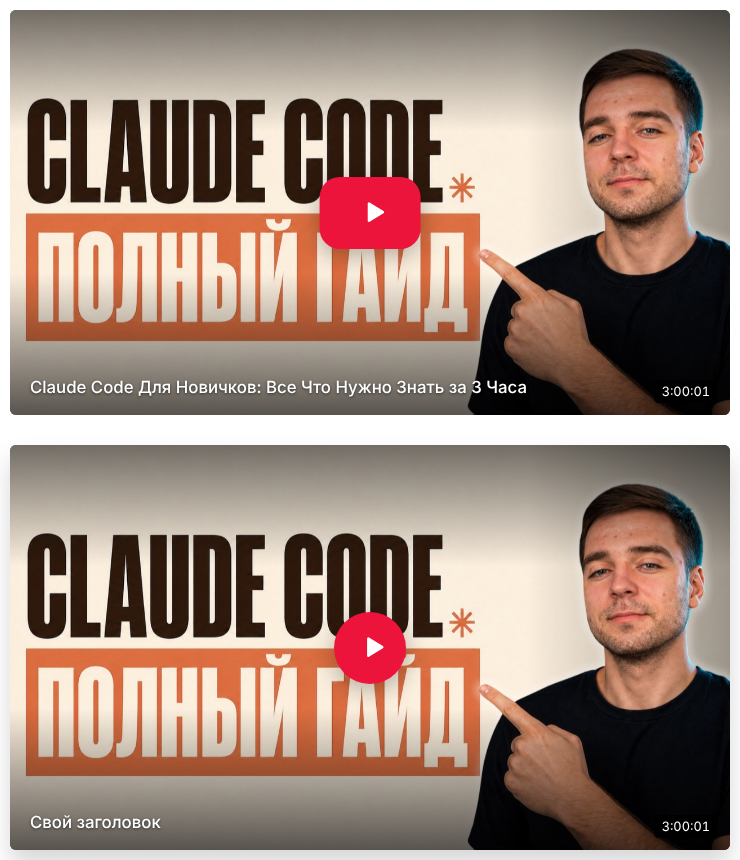

# YT RuTube

**Отложенная загрузка видео RuTube для YOOtheme Pro на Joomla** — элемент конструктора, который показывает лёгкую обложку с кнопкой Play и загружает плеер RuTube, только когда он нужен. Та же идея, что у Lazy Video для YouTube и Vimeo, но для RuTube.

[English version](README.md)

Обычная вставка RuTube загружает вместе со страницей весь плеер, его скрипты, рекламу и счётчики. YT RuTube выводит только картинку и кнопку, а iframe появляется после клика. Страницы открываются быстрее, а сторонние cookie не ставятся, пока посетитель не решит посмотреть видео.



## Возможности

**Элемент RuTube** (группа *Multimedia* в библиотеке элементов YOOtheme Pro)

- Принимает любую ссылку RuTube: `rutube.ru/video/…`, `/shorts/…`, скрытые видео `/video/private/…?p=…`, `/play/embed/…`, полный код вставки `<iframe>` или просто ID видео. `?t=90` в ссылке задаёт время старта.
- Название, обложка и длительность берутся из API RuTube на сервере и кешируются. Можно задать свою обложку и заголовок. Все поля поддерживают динамический контент.
- Режимы загрузки: **по клику на месте**, **по клику в лайтбоксе** (UIkit) и **при появлении на экране**.
- Соотношение сторон: 16:9, 4:3, 21:9, 1:1, 4:5, 9:16 (Shorts) или своё.
- Кнопка Play: в стиле RuTube, круг, круг с обводкой, только иконка или без кнопки; три размера, свои цвета.
- Затемнение обложки (лёгкое, тёмное, градиент), увеличение при наведении, заголовок сверху или снизу, длительность, скругление, тень.
- Настройки плеера: время старта, запуск без звука, цвет плеера, пауза других видео RuTube на странице. Применяются через официальный [postMessage API плеера RuTube](https://github.com/rutube/RutubePlayerJSAPI).
- SEO: микроразметка `VideoObject` (JSON-LD) — название, описание, обложка, длительность и дата публикации.
- Доступность: обложка — это `<button>` с `aria-label`, работает с клавиатуры, есть вариант для `<noscript>`.
- Стандартные вкладки YOOtheme *General* и *Advanced*: отступы, максимальная ширина, выравнивание, анимация, видимость, свой CSS.
- Русский и английский перевод конструктора и сайта.

## Требования

- Joomla 5.0 или новее
- YOOtheme Pro 5
- PHP 8.1 или новее
- Исходящие HTTPS-запросы с сервера к `rutube.ru` для названий и длительности (обложки работают и без них)

## Установка

1. Скачайте `plg_system_ytrutube_<версия>.zip` в разделе [Releases](../../releases).
2. В Joomla откройте «Система → Установка → Расширения» и загрузите файл. Плагин включится автоматически.
3. Откройте «YOOtheme → Конструктор», нажмите **+** и добавьте элемент **RuTube**. Вставьте ссылку на видео, например `https://rutube.ru/video/2a55da78983c76a6fcfbfb324313fc4b/`.

Чтобы обновить плагин, установите новую версию поверх старой или воспользуйтесь «Система → Обновление → Расширения».

## Настройки плагина

| Настройка | По умолчанию | Описание |
|---|---|---|
| Кеш данных видео | 720 мин | Сколько хранить название, обложку и длительность из API RuTube. Неудачные запросы повторяются через час. |

Чтобы обновить данные сразу, очистите группу `plg_system_ytrutube` в «Система → Очистить кеш».

## Разработка

```
src/
  plg_system_ytrutube/   системный плагин
    modules/element/     элемент конструктора RuTube (element.json, шаблоны)
    modules/src/         RutubeHelper (ссылки, API, кеш), переводы конструктора
    modules/assets/      CSS и JS для сайта
tests/                   PHP-тесты (разбор ссылок, времени и пропорций)
updates/                 XML сервера обновлений Joomla
build.sh                 проверки, тесты и сборка dist/plg_system_ytrutube_<версия>.zip
```

```sh
./build.sh          # проверка PHP, JSON и JS, тесты, сборка
./build.sh --fast   # только сборка
```

Релизы публикует GitHub Actions. Для новой версии обновите номер в `ytrutube.xml`, `RutubeHelper::VERSION`, `updates/plg_system_ytrutube.xml` и `CHANGELOG.md` и отправьте изменения в `main`. Если для этой версии ещё нет релиза, workflow создаст тег `vX.Y.Z` и релиз с установочным файлом.

## Лицензия

GNU General Public License версии 2 или новее. См. [LICENSE](LICENSE).

YOOtheme Pro, RuTube и Joomla — товарные знаки их владельцев. Проект не связан с YOOtheme GmbH, RuTube или Open Source Matters.
